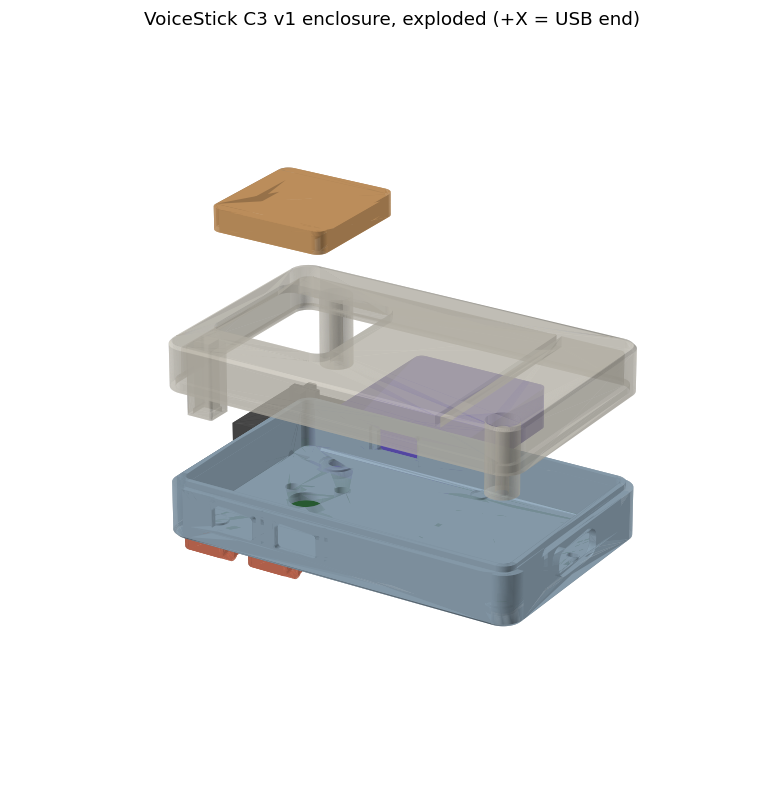
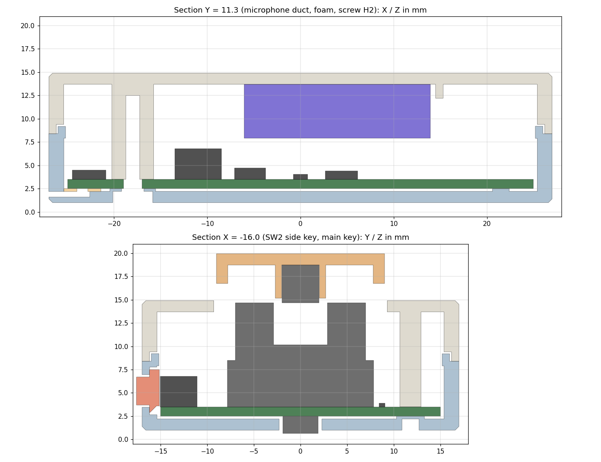

# VoiceStick C3 v1 enclosure

English · [简体中文](README_ZH.md)

For one device, print LowerShell, UpperShell, MainCap and one each of SideCap_SW2, SideCap_SW3 and SideCap_SW4. ToleranceCoupon and AcousticTestBox are test pieces. LowerShell_OpenDuct is an alternate lower shell for acoustic comparison.

The parts are under `enclosure/out/` in `voicestick-c3-v1-build-files.zip`. [Build archive details](../../README.md#v1-release-files)

| File | Use |
| --- | --- |
| `stl/` | Already oriented on the print bed. Slice with your printer and filament profile. |
| `step/` | Use for CAD changes or import into a slicer with STEP support. They use assembly coordinates. Place each part on the face listed below before slicing. |
| `voicestick-c3-v1-assembly.step` | Inspect the assembled device, including the populated PCB, battery and foam. |
| [Enclosure report](out/enclosure-report.json) | Dimensions, mesh integrity, key travel, clearances and interference checks. |

## Print settings

Light-coloured PETG lets both indicators shine through their 0.6 mm windows. PLA can be used for fit tests. The top window carries the RGB indicator and the USB-end window carries the charging indicator. All parts are designed to print without support.

| Part | Face on the build plate | Profile |
| --- | --- | --- |
| LowerShell, LowerShell_OpenDuct, AcousticTestBox | Base down, acoustic channel up where present | 0.2 mm layers, 4 walls, 6 top/bottom layers, 20% infill |
| UpperShell | Exterior roof down | Same as LowerShell |
| MainCap | Top face down | 0.12 mm layers, 100% infill |
| SideCap_SW2/SW3/SW4 | Inner flange face down | Same as MainCap |
| ToleranceCoupon | Flat | Same as LowerShell |

Print the coupon first. Test the switch stem at −0.05, 0 and +0.05 mm socket offsets, the M2 screw in the 1.5/1.6/1.7 mm pilot holes and a side cap in the 0.2/0.25/0.3 mm gaps. Check the acoustic channel and USB cable fit. Adjust the matching dimensions in [assembly-interface.json](../assembly-interface.json) before printing the shells.

For an acoustic seal test, fit the foam and clamp the PCB to AcousticTestBox at H2 with an M2 screw and nut. Record a sweep with the outlet open, then taped shut. A drop of over 20 dB is the design target. A smaller change warrants checking the foam seal. LowerShell_OpenDuct allows an open-cavity comparison without foam.

## Parts and assembly

| Hardware | Quantity |
| --- | --- |
| M2 × 10 mm pan-head PT self-tapping screws | 2 |
| 0.5 mm adhesive PORON or closed-cell EVA foam, 4 × 3 mm with a 1.2 mm centre hole | 1 |
| 6 mm diameter × 1 mm adhesive silicone feet | 4 |
| 0.1 mm polyimide tape, approximately 20 × 28 mm | 1 piece |
| 0.1–0.2 mm double-sided battery tape | 1 piece |
| Protected 602025 250 mAh battery, two-pin JST SH 1.0 mm | 1 |

1. Stick the foam into the lower shell. Align its hole with the channel directly below the microphone port and seat the foam against the end wall.
2. Insert the three side caps from inside, flanges inward and chamfered corners down.
3. Rest the PCB on the two screw bosses and four supports. Pass the main switch tail through the lower opening.
4. Insulate the PCB below the battery with polyimide tape. Tape the battery to the inside of the roof against the USB-end rib.
5. Route the leads beneath the battery and connect J2, checking pin 1 is positive and pin 2 is ground.
6. Align the shells and install both screws from below. Press on the main cap and fit the four feet, two over the screw heads and two under the corner supports.

The CAD checks cover rest, 4 mm main-key travel and each side key at full travel. Minimum modelled clearances include 0.4 mm from the 6.5 mm battery envelope to board parts, 0.4 mm around the USB connector, 0.35 mm below board parts and leads, and 0.1 mm at the pressed key stops. The two diagonal screws keep metal away from the antenna and leave space for the RGB light guide.

To rebuild from the repository root on the hardware design toolchain, run `cd hardware/voicestick_c3` then `./make.sh enclosure`. This reads the shared dimensions and PCB envelopes, checks the parts and writes the models, report and previews into `out/`.
