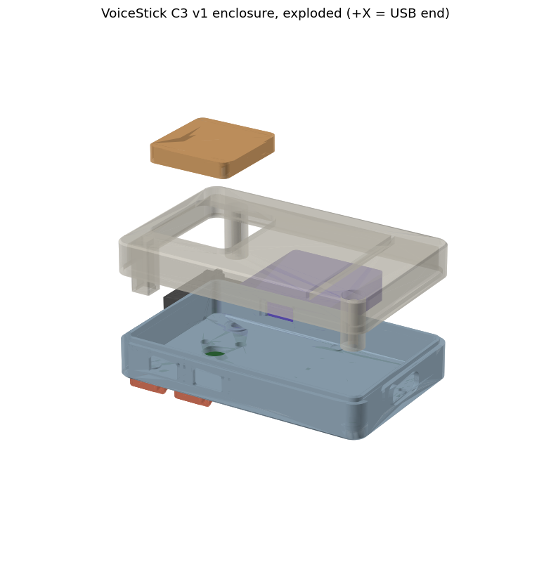
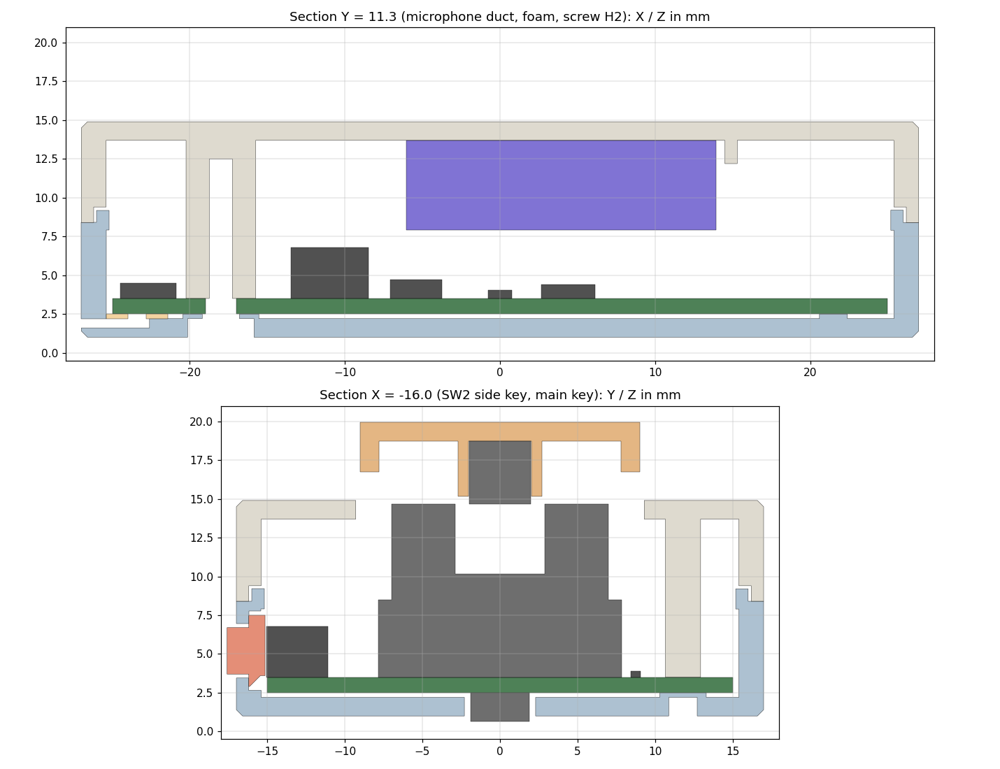

# VoiceStick C3 v1 外壳（FDM 打印）

[English](README.md) · 简体中文

装一台需要上壳、底壳、主键帽和三个侧键帽，共六件。ToleranceCoupon 和 AcousticTestBox 用于试打，LowerShell_OpenDuct 用于声学对比。

外壳完全由脚本生成：`build_enclosure.py` 读 `../assembly-interface.json`（机械接口，与 PCB 共用）和 `pcb-envelopes.json`（由 `../tools/export_envelopes.py` 从最终 PCB 导出的元件外形和高度）。改尺寸只改接口文件，然后：

```bash
cd hardware/voicestick_c3
./make.sh enclosure     # 导出元件包络 -> 建模 -> 干涉/间隙检查 -> STEP/STL -> 预览图
```

干涉或间隙不达标时脚本会以非零退出码结束；结果写在 `out/enclosure-report.json`。



## 输出

零件文件位于 `voicestick-c3-v1-build-files.zip` 的 `enclosure/out/` 目录。[复刻包说明](../../README_ZH.md#v1-发布附件)

| 文件 | 内容 |
| --- | --- |
| `stl/` | 打印件，已经按打印方向摆好，直接导入切片软件 |
| `step/` | 同样的零件，保留装配坐标。可在 CAD 中改尺寸，或直接导入支持 STEP 的切片器，按下表选择贴床面 |
| `voicestick-c3-v1-assembly.step` | 整机静止状态：外壳 + PCB（含元件 3D）+ 电池/泡棉/脚垫参考体 |
| `out/enclosure-report.json` | 体积、打印尺寸、网格检查、三种状态的干涉结果、关键间隙 |
| `out/preview-*.png` | 爆炸图和两个剖面 |



## 打印件与参数

材料推荐 PETG：耐温约 70 °C，充电发热时不变形。PLA 可以打样。外壳用浅色耗材，两颗灯都透过 0.6 mm 薄壁显示。灯窗在外表面看不出来，灯亮了才透光：
- WS2812：顶面，主键 −Y 一侧的角上，经导光筒；
- 充电灯：USB 端面，USB 口旁边，侧发光灯直接照在端墙上。

如果用深色耗材，就把灯窗钻穿，滴 UV 胶。

| 零件 | 打印方向 | 参数 | 支撑 |
| --- | --- | --- | --- |
| ToleranceCoupon（40×20） | 平放 | 与外壳相同 | 无 |
| AcousticTestBox | 底面朝下 | 与底壳相同 | 无 |
| LowerShell | 底面朝下（声槽朝上） | 0.2 mm 层高，4 圈墙，顶底 6 层，20 % 填充 | 无 |
| UpperShell | 顶面朝下（STL 已翻转） | 同上 | 无 |
| MainCap | 顶面朝下（STL 已翻转） | 0.12 mm 层高，100 % 填充 | 无 |
| SideCap_SW2/SW3/SW4 | 凸缘内侧面贴平台（STL 已转好） | 0.12 mm 层高，100 % 填充 | 无 |
| LowerShell_OpenDuct | 底面朝下 | 只用于声学 A/B 对比，不装机 | 无 |

建模规则：所有孔径都已加大 0.2 mm（`fdm.hole_oversize`），打出来就是名义尺寸。贴平台的外边缘有 0.4 mm 倒角，用来抵消首层外扩。侧键窗顶边桥接 6.5 mm。声槽穿过端墙的部分是 1.2 mm 宽的短桥，不需要支撑。

## 先打试件

1. **ToleranceCoupon**，从左到右依次是：
   - 主键轴口三档，十字槽尺寸分别加 −0.05 / 0 / +0.05 mm；
   - M2 自攻底孔三档：Ø1.5 / 1.6 / 1.7；
   - 一段声槽和端墙隧道，看隧道有没有塌、槽有没有堵。

   后墙上是三个侧键窗（单边间隙 0.2 / 0.25 / 0.3）和一个 USB-C 开口。

   试法：
   - 拿一个 CPG151101D05 的轴插进轴口，选插得进、不晃的那一档；
   - 用 M2×10 自攻螺钉试拧，选拧得进、不裂的那一档；
   - 把打好的侧键帽放进窗口，选滑动顺、不卡的那一档；
   - 用 USB-C 线插到底，确认能插进去。

   把结果写回 `assembly-interface.json`：
   - `main_key.stem_socket.cross_long/cross_width`（加上选中的那一档偏差）；
   - `fasteners.upper_pilot_hole`；
   - `side_keys.cap_clearance`；

   然后重跑 `./make.sh enclosure`。
2. **AcousticTestBox**（底壳主键端截取一段，带完整声槽、泡棉位、H2 螺钉柱和角上的支撑点）：
   - 贴好泡棉，在 H2 用 M2 螺钉加螺母把实板压上去。
   - 录两段扫频：一段端面出口敞开，一段出口用胶带封死。封死后电平应该下降 20 dB 以上，说明泡棉密封有效。降得少，就是泡棉在板边间隙处漏气，需要加宽泡棉或换更软的泡棉。
3. 想比较"密封声道"和"敞开进声"的差别，可以用 **LowerShell_OpenDuct** 替换底壳，其余件不变：这个底壳没有声槽，端面开了三个 Ø0.6 的孔通到壳内腔，不贴泡棉。

## 外购件

| 件 | 规格 | 数量 |
| --- | --- | --- |
| 自攻螺钉 | M2×10 盘头 PT 牙 | 2 |
| 泡棉 | PORON 或闭孔 EVA，自由厚 0.5 mm，单面背胶，裁 4.0×3.0 mm，中间冲 Ø1.2 孔 | 1 |
| 硅胶脚垫 | Ø6 × 1.0 mm，背胶 | 4 |
| 聚酰亚胺胶带 | 0.1 mm，垫在 PCB 电池投影区 | 约 20×28 mm |
| 双面胶 | 0.1–0.2 mm，贴电池 | 1 片 |
| 电池 | 602025 250 mAh，带保护板，JST SH 1.0 两针 | 1 |

## 装配顺序

1. 底壳贴泡棉：胶面朝下，孔对准声槽起点（板上麦克风声孔的正下方），泡棉要压到端墙内侧。
2. 从壳内把 3 个侧键帽塞进侧键窗：凸缘留在墙内侧，有斜面的一角朝下。
3. 放 PCB：落在 2 个螺钉凸台和 4 个支撑点上，主键尾部从底壳开孔穿出。
4. 在 PCB 的电池投影区贴聚酰亚胺胶带；电池用双面胶贴到上壳顶内侧，USB 端顶住定位筋。
5. 电池线插到 J2，线从电池下方绕到插座。
6. 合上上壳，止口对位，从底部拧 2 颗 M2×10 螺钉。螺钉同时夹住上壳、PCB 和底壳。
7. 压上主键帽，在底面贴 4 个脚垫：2 个盖住螺钉头，2 个贴在天线角和 WS2812 角的支撑点下方。

## 检查结果（`enclosure-report.json`）

- 静止、主键按到底（4.0 mm）、每个侧键按到底（推杆间隙 0.15 + 开关行程 0.2）三种状态下，零件之间都没有干涉。
- 关键间隙（单位 mm，括号里是要求值）：

  | 位置 | 间隙 |
  | --- | --- |
  | 电池（按实测 5.8 mm）到元件 | 1.1（0.5） |
  | 电池（按 6.5 mm 包络，含鼓包余量）到元件 | 0.4（0.3） |
  | 上壳柱子、导光筒到元件 | 0.2（0.2） |
  | USB 插座到外壳 | 0.4 |
  | 主键按到底时，键帽到开关壳体 | 0.1 |
  | 侧键按到底时，键帽到 PCB | 0.1 |

- 底壳到元件和插件引脚至少 0.35。所有通孔引脚（主键尾部、USB 固定脚）在底壳上都有避让孔。

## 与计划的差异

- **螺钉 2 颗，不是 4 颗**，两颗在对角（主键端 +Y 的 H2、USB 端 −Y 的 H3）：
  - USB 端 +Y 角是天线角，金属螺钉会让天线失谐，改为塑料支撑点；
  - 主键端 −Y 角放 WS2812 的灯窗（和麦克风对称），改为塑料支撑点。主键按下的力由这个支撑点承担，这个角的上下壳靠止口扣住；
  - 两个支撑点下面都贴脚垫，所以 4 个脚垫仍在四个角上，放在桌上按主键不会翘。
- **脚垫高 1.0 mm**。CPG151101D05 外形图标注的 2.85 mm 从轴座底面量到中央塑料柱末端。装在 1.0 mm 厚的 PCB 上，塑料柱标称露出 1.85 mm。模型按板背以下 2.15 mm 给轴脚留位，对应离桌面 0.35 mm。两根金属端子略长于塑料柱，焊后的最低点需用实物复核。
- **电池定位筋只做了 USB 端一条**：电池两条长边就是壳壁；主键端是键帽开口，没有顶板可挂筋。电池主要靠双面胶固定。
- **侧键帽凸缘加了斜面**：凸缘下沿低于 PCB 顶面，不切的话按键按到底时会碰到板边。内下角切 45° 后打印方向不变，也不需要支撑。
- **公差试打件做成 40×20 mm，不是 20×15 mm**：一块板上要放下全部 5 组试样。
- **声学测试盒**：计划要求做"带/不带密封声道"两种。带密封的是截取的测试盒；不带密封的做成了整只底壳（LowerShell_OpenDuct），因为敞开进声的效果取决于整个壳内腔，截一段测不出来。
