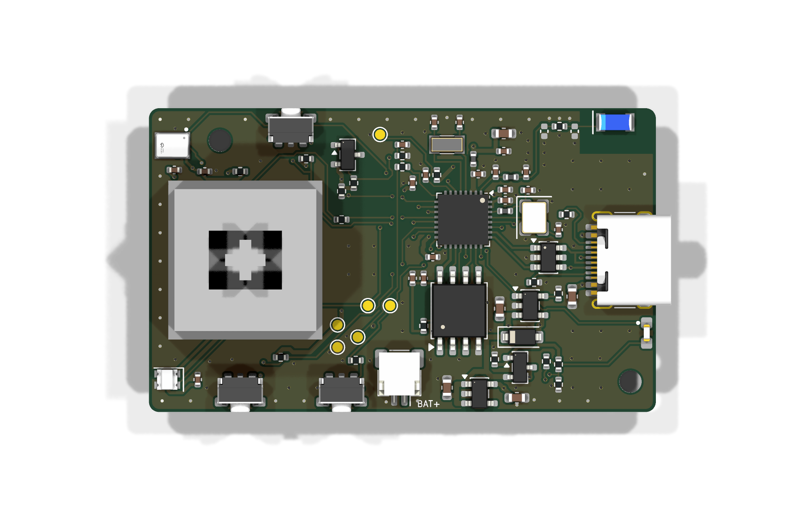

# VoiceStick C3 v1 PCB fabrication

English · [简体中文](README_ZH.md)

Extract `voicestick-c3-v1-build-files.zip` from the [hardware release files](../../README.md#v1-release-files) and open its `fab/` directory.

Use the Gerber ZIP (`voicestick-c3-v1-gerber.zip`) for the bare board, and the BOM (`voicestick-c3-v1-bom.csv`) and placement CSV (`voicestick-c3-v1-cpl.csv`) for assembly. The ZIP contains eleven plotted layers, the Gerber job file, and separate plated and non-plated drill files. The board STEP (`voicestick-c3-v1.step`) and the [bottom view](voicestick-c3-v1-bottom.png) help identify components and check orientation.

## Bare-board order

| Parameter | Design value |
| --- | --- |
| Outline | 50 × 30 mm, 1 mm corner radius |
| Layers and thickness | Four layers, 1.0 mm overall |
| Stack-up | JLC04101H-3313, 0.0994 mm 3313 prepreg on each side of a 0.69 mm core |
| Copper | 1 oz outer, 0.5 oz inner |
| Finish | ENIG for flat QFN and USB-C pads. Lead-free HASL is also possible. |
| Mask and vias | Green or black mask. Tented vias, 0.3 mm drill with 0.45 mm or 0.6 mm outer diameter. |
| Track / gap | 0.15 / 0.127 mm, locally 0.1 mm at QFN pads |
| RF feed | Grounded coplanar waveguide over L2, 0.15 mm track with 0.25 mm gap to the pour. Estimated 47.7 Ω. Check against the selected stack-up before ordering. |
| USB | Full-speed differential pair, 12 Mbit/s |

U1's exposed ground pad has nine thermal vias. The split paste apertures keep paste away from the via rows. The design uses ordinary tented vias.

## Assembly order

All placements are on top. Check the LCSC matches, inventory and suggested substitutions when ordering, especially SW1–SW4, J2 and the microphone. Check polarity and rotations for U1–U6, Q1/Q2, D1–D3, J1/J2, Y1/Y2 and AE1 in the assembler's preview. D3's lens faces the USB end. SW1 (CPG151101D05) is through-hole. Select through-hole assembly or leave SW1 for hand soldering.

Populate C18/L3/C19 at 1.5 pF / 2.4 nH / 1.5 pF. Fit R20 with 0 Ω and leave C25 and C26 unpopulated for antenna tuning. Component selections are defined in [design.py](../tools/design.py). Running `python3 tools/bom_cost.py --boards 5,50,1000` from the version directory estimates component cost before assembly, stencil and setup fees.

## First power-up

1. Leave the battery disconnected. Connect USB and measure VBUS (5 V), VSYS (about 4.7 V) and +3V3 (3.3 V). The charge LED may flicker without a battery.
2. Connect a protected battery to J2 after checking its polarity. The red LED should light while charging and may glow faintly when full. Unplug USB and verify that +3V3 is maintained.
3. Run `python -m esptool --chip esp32c3 flash-id` in the ESP-IDF environment. The expected flash is the 8 MB GigaDevice GD25Q64 (manufacturer C8, device 4017).
4. Measure the 40 MHz crystal frequency offset. The starting load capacitors are 22 pF at C14/C15. Check tuning if the offset exceeds ±10 ppm.
5. Start RF measurements on the chip side with R20 removed. Attach the coax at pad 1 and nearby ground. The initial chip-side conjugate target is about 35 Ω. Adjust C18/L3/C19 within 1.2–1.8 pF / 2.0–3.0 nH / 1.2–1.8 pF. With the battery and case fitted, measure antenna S11 from pad 2 and tune C25/R20/C26 towards 50 Ω at 2.4–2.5 GHz.

To regenerate these files, run `./make.sh` from `hardware/voicestick_c3/`. Check the ERC, DRC, board and enclosure results before using a modified design.
