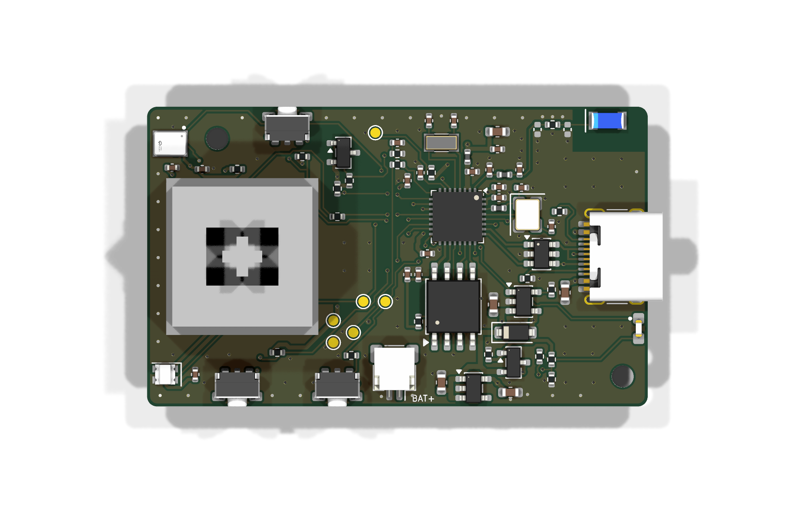

# VoiceStick C3 v1 制造说明（嘉立创）

[English](README.md) · 简体中文

从[硬件复刻指南](../../README_ZH.md#v1-发布附件)选择 `voicestick-c3-v1-build-files.zip`，解压后使用 `fab/` 内的制造文件。

制造文件由 `../make.sh` 生成，不要手改。下单前先跑一遍 `./make.sh`，确认末尾打印 `DRC: 0 errors`、`board checks: OK`、`enclosure OK`。

## 文件

| 文件 | 用途 |
| --- | --- |
| `voicestick-c3-v1-gerber.zip` | PCB 下单：11 层光绘、Gerber job 文件和分开的 PTH / NPTH 钻孔文件 |
| `voicestick-c3-v1-bom.csv` | SMT 下单 BOM（Comment / Designator / Footprint / MPN / LCSC） |
| `voicestick-c3-v1-cpl.csv` | SMT 坐标文件，只含顶层、已去掉不贴的件 |
| `voicestick-c3-v1.step` | 整板 3D（外壳脚本和装配检查用） |
| `voicestick-c3-v1-top.png` / `-bottom.png` | 渲染图，下单时对照 |

## PCB 下单参数

| 项目 | 选择 |
| --- | --- |
| 层数 / 板厚 | 4 层，1.0 mm |
| 叠层 | JLC04101H-3313：L1–L2、L3–L4 为 3313 预浸料 0.0994 mm（Er 4.1），中间 0.69 mm 芯板。与 7628 同价，介质薄、线宽窄，更适合射频和 QFN 出线 |
| 尺寸 | 50 × 30 mm，圆角 R1 |
| 外层铜厚 / 内层铜厚 | 1 oz / 0.5 oz |
| 表面处理 | 沉金（推荐：QFN 0.5 mm 间距、Type-C 焊盘平整）；无铅喷锡也可 |
| 阻焊 | 绿色或黑色均可；过孔塞油（嘉立创多层板默认，不加价） |
| 过孔 | 0.45/0.3 mm（信号，95 个）与 0.6/0.3 mm（电源与地缝合，125 个）；最小孔径选 0.3 mm（外径 0.4/0.45），免费档；**不需要树脂塞孔、不需要电镀盖帽** |
| 最小线宽 / 线距 | 0.15 / 0.127 mm（QFN 焊盘处局部 0.1） |
| 阻抗 | 天线馈线为接地共面波导：L1 线宽 0.15、到地铜 0.25，参考 L2 整层地，按公式估算 47.7 Ω。用嘉立创阻抗计算器（选 JLC04101H-3313、共面单端带地）核对一次；如果偏差超过 ±5 Ω，改 `tools/impedance.py` 里的 `RF_WIDTH` 后重跑 |
| USB | 全速 12 Mbit/s，差分对走线等长、紧耦合即可，不要求阻抗 |

过孔说明：唯一的焊盘内过孔是 U1（ESP32-C3）散热焊盘下的 9 个 0.45/0.3 GND 过孔（乐鑫要求至少 9 个）。钢网把这块焊盘的锡膏分成四块，过孔都在中间的十字缝里，所以塞油不影响焊接，反而能防止锡被吸进孔里；不需要树脂塞孔或电镀盖帽。`tools/check_board.py` 会检查，除这一处外没有任何过孔落在焊盘里。

## SMT 贴片

- 单面贴片（全部在顶层）。射频有两组 π 型匹配：
  - 芯片侧 C18/L3/C19 紧贴 U1 的 1 脚，按乐鑫推荐值贴 1.5 pF / 2.4 nH / 1.5 pF；
  - 天线侧 C25/R20/C26 在天线禁布区边上，R20 贴 0 Ω，C25/C26 **默认不贴**，装壳后用 VNA 调好再补焊。
- BOM 每一行都已填 LCSC 料号。阻容全部是基础库，其余为扩展库。料号在 `tools/design.py` 里改（阻容在 `PASSIVES` 表），重跑 `./make.sh` 后 BOM 会自动更新。
- 料费估算：`python3 tools/bom_cost.py --boards 5,50,1000`。脚本按嘉立创接口的阶梯价、损耗数和最小用量计算，价格是国际站美元价，不含贴片工程费、钢网费、扩展料换料费和焊点费。
- 上传 BOM 后核对三件事：
  - 所有行都匹配上，库存够；
  - 没有被替换成别的料；
  - 按键 SW1–SW4、电池座 J2 匹配到的是 BOM 里的型号。
- 库存偏少、下单时要留意的料：
  - SW2–SW4 侧键 SKRTLBE010，约 1200 个；
  - SD18OB371-041 麦克风，约 1500 个；
  - SW1 主键，约 2600 个。
- 坐标文件的旋转角是 KiCad 的定义。嘉立创自动匹配后，**在 DFM 预览里逐个核对一遍极性件和多脚件**：U1–U6、Q1/Q2、D1–D3、J1/J2、Y1/Y2、AE1。方向错了就在下单页调，不用改源文件。D3 是侧发光灯，除了极性，还要确认透镜朝板边（USB 端面）。
- 手焊件：主键 CPG151101D05 是通孔件，BOM 里已经带了料号（C49234236）。可以勾选嘉立创的插件焊接服务让他们代焊；如果打算自己焊，就在下单页把 SW1 设为不贴。电池接 J2（JST SH 1.0 两针）。

## 首板上电检查

1. 不装电池，插 USB：VBUS 5 V，VSYS 约 4.7 V，+3V3 为 3.3 V。没装电池时，TP4054 不充电或红灯闪烁都属正常。
2. 装电池：
   - 红灯常亮，表示正在充电；
   - 充满后 CHRG 只剩约 20 µA 的弱下拉，红灯变为微亮；
   - 拔掉 USB 后 +3V3 仍为 3.3 V，说明 AO3401A 已切换到电池供电。
3. `esptool.py --chip esp32c3 flash_id`：应读到 GigaDevice（厂商 ID `c8`）GD25Q64（设备 ID `4017`，8 MB）。
4. 40 MHz 晶振的负载电容 C14/C15 按 15 pF 负载估算为 22 pF。用频谱仪或 RF 测试固件测一下频偏，超过 ±10 ppm 就调这两颗电容。
5. 射频匹配，分两步：
   - 芯片侧：取下 R20，从 R20 的 1 脚和旁边地接出同轴线，看进去应接近乐鑫给的共轭点 35 Ω。在推荐范围内调 C18/L3/C19（1.2–1.8 pF / 2.0–3.0 nH / 1.2–1.8 pF）。乐鑫推荐值是按 0201 封装和他们的布局给的，这块板用 0402，数值会有偏差。
   - 天线侧：装好外壳和电池后，从 R20 的 2 脚接 VNA 测天线 S11，在 C25/R20/C26 上把 2.4–2.5 GHz 调到 50 Ω 附近。
